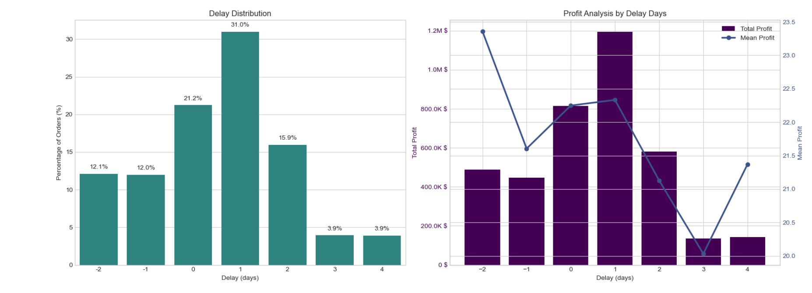
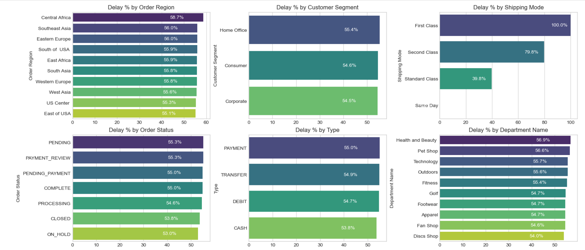
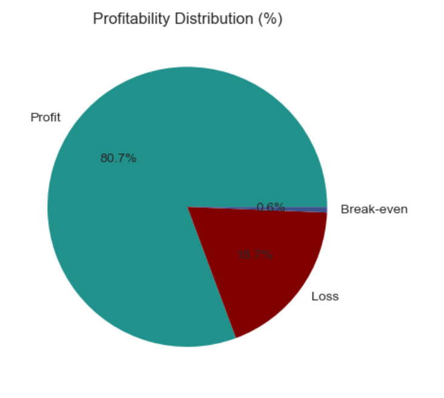
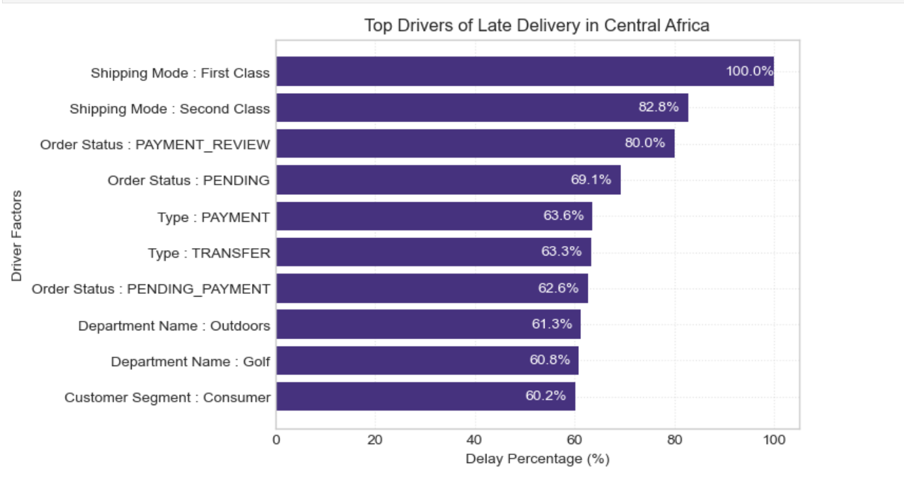
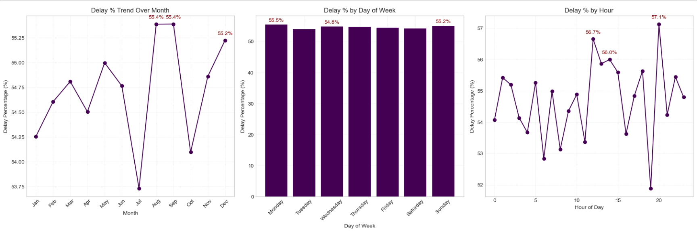

# Supply Chain Delivery Performance Analysis

<p align="center">


</p>

---

# Project Overview

This project presents an end-to-end supply chain delivery performance analysis using Python. The objective is to evaluate delivery performance, identify operational bottlenecks, analyze profitability, and generate actionable business insights through data-driven decision-making.

The project follows a complete data analytics workflow including data cleaning, exploratory data analysis (EDA), feature engineering, KPI analysis, bottleneck analysis, root cause analysis, and time-based analysis.

---

# Project Objectives

- Clean and preprocess raw supply chain data
- Perform exploratory data analysis (EDA)
- Engineer meaningful business features
- Measure key business KPIs
- Analyze delivery delay patterns
- Identify operational bottlenecks
- Investigate root causes of delays
- Generate actionable business recommendations

---

# Dataset

**Dataset:** DataCo Supply Chain Dataset

The dataset contains information related to:

- Customer Orders
- Products
- Shipping Modes
- Delivery Status
- Sales
- Profit
- Customer Segments
- Markets
- Regions
- Departments

---

# Technologies Used

- Python
- Pandas
- NumPy
- Matplotlib
- Seaborn
- Jupyter Notebook

---

# Project Workflow

### 1. Data Loading

- Imported dataset
- Examined dataset structure
- Checked data types
- Inspected missing values

### 2. Data Cleaning

- Removed unnecessary columns
- Converted date columns
- Filtered cancelled orders
- Handled missing values
- Corrected inconsistent data

### 3. Exploratory Data Analysis (EDA)

Analyzed:

- Sales
- Profit
- Delivery Status
- Shipping Modes
- Customer Segments
- Regions
- Departments

### 4. Feature Engineering

Created new business features including:

- Delivery Delay
- Order Processing Time
- Order Month
- Order Weekday
- Order Hour

### 5. Business KPIs

Calculated:

- Total Orders
- Total Sales
- Total Profit
- Average Profit
- Average Delivery Time
- Delay Rate
- On-Time Delivery Rate

### 6. Bottleneck Analysis

Analyzed operational bottlenecks across:

- Shipping Modes
- Departments
- Regions
- Customer Segments

### 7. Root Cause Analysis

Investigated delivery delays based on:

- Shipping Mode
- Department
- Region
- Customer Segment
- Market

### 8. Time-Based Analysis

Studied delivery trends across:

- Months
- Weekdays
- Order Hours

---

# Visualizations

The project includes visual analyses for:

- Delivery Delay Distribution
- Delivery Delay by Category
- Profitability Distribution
- Root Cause Analysis
- Time-Based Delay Analysis

---

## Sample Visualizations

### Delivery Delay Distribution



---

### Delivery Delay by Category



---

### Profitability Distribution



---

### Root Cause Analysis



---

### Time-Based Delay Analysis



---

# Key Business Insights

- A significant proportion of orders experienced delivery delays.
- Delivery delays negatively impacted profitability.
- Certain shipping modes consistently showed higher delay rates.
- Specific regions and departments experienced operational bottlenecks.
- Delivery performance varied across months, weekdays, and order hours.
- Seasonal and operational factors influenced delivery efficiency.

---

# Business Recommendations

- Improve logistics planning in high-delay regions.
- Optimize shipping mode selection.
- Monitor departments with recurring delivery issues.
- Allocate additional resources during peak demand periods.
- Use predictive analytics to anticipate delivery delays.

---

# Project Structure

```text
Supply_Chain_Delivery_Analysis/
│
├── data/
│   └── DataCoSupplyChainDataset.csv
│
├── images/
│   ├── delay_distribution.png
│   ├── delivery_delay_by_category.png
│   ├── profitability_distribution.png
│   ├── root_cause_analysis.png
│   └── time_based_delay_analysis.png
│
├── notebook/
│   └── Supply_Chain_Analysis.ipynb
│
├── README.md
├── requirements.txt
└── LICENSE
```

---

# Future Improvements

- Build an interactive Power BI dashboard
- Develop a Streamlit web application
- Apply Machine Learning to predict delivery delays
- Automate reporting using scheduled data pipelines

---


# Author

**Tanzila Dewan**

B.Sc. in Computer Science & Engineering

Data Analyst

### Skills

- Python
- SQL
- Pandas
- NumPy
- Excel
- Power BI
- Data Visualization


- **GitHub:** [TanzilaDewan789](https://github.com/TanzilaDewan789)
- **LinkedIn:** [Tanzila Dewan](https://www.linkedin.com/in/tanzila-dewan/)

---


> **"Turning raw data into meaningful business insights through analytics."**